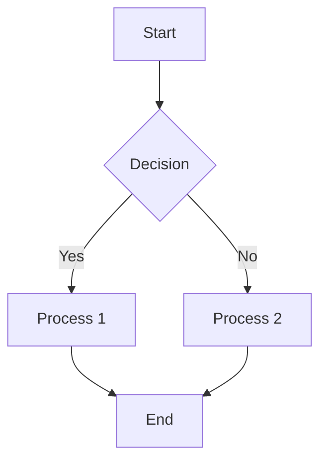

# Markdown Syntax Guide: From Beginner to Interview-Ready

> **"Markdown is the simplest way to write formatted text that can be converted to HTML."**
>
> This guide is designed for **coding beginners** but covers everything you need for **technical interviews** and **project operations**. We'll cover basics, common pitfalls, and real-world applications.

---

## 1. Headings (제목)

Headings structure your document and are crucial for readability.

| Syntax | Result |
|--------|--------|
| `# Heading 1` | largest heading |
| `## Heading 2` | |
| `### Heading 3` | |
| `#### Heading 4` | |
| `##### Heading 5` | |
| `###### Heading 6` | smallest heading |

### Interview Tip
- Always use `# ` at the start of a line (with a space after `#`)
- Headings create an automatic table of contents in many renderers
- **Project Ops**: Use consistent heading hierarchy (H1 for title, H2 for sections, H3 for subsections)

### Troubleshooting
- **Problem**: Heading not displaying properly
- **Cause**: Missing space after `#`
- **Fix**: `# Heading` → `# Heading` (ensure one space between `#` and text)

---

## 2. Text Formatting (텍스트 형식화)

### Basic Styling

| Syntax | Result | Interview Note |
|--------|--------|----------------|
| `**bold**` | **bold** | Common in README files |
| `*italic*` | *italic* | Emphasis for key terms |
| `***bold and italic***` | ***bold and italic*** | Combine for emphasis |
| `__underline__` | __underline__ | Less common, use sparingly |

### Code Literal Text

```md
`variable_name` renders as: variable_name
```

**Interview Question**: "What's the difference between `**bold**` and `__underline__`?"
- **Answer**: `**bold**` is standard Markdown; `__underline__` is not standard (varies by renderer) and should be avoided in cross-platform docs.

### Troubleshooting
- **Problem**: Text not formatting correctly
- **Cause**: Missing spaces around formatting symbols
- **Fix**: Ensure spaces between text and `**`/`*`
  - ✅ `** hello **` 
  - ❌ `**hello**` (may not render)

---

## 3. Lists (목록)

### Unordered Lists

```md
- Item 1
- Item 2
  - Sub-item 2-1
  - Sub-item 2-2
- Item 3
```

### Ordered Lists

```md
1. First step
2. Second step
   1. Nested step 2.1
   2. Nested step 2.2
3. Third step
```

### Checklists (GitHub Flavored Markdown)

```md
- [x] Completed task
- [ ] Pending task
- [ ] Another task
```

**Interview Tip**: Checklists are perfect for project status reports and sprint tracking.

### Troubleshooting
- **Problem**: List indenting not working
- **Cause**: Missing indentation (2 spaces) for sub-items
- **Fix**: Sub-items must be indented with 2 spaces relative to parent

---

## 4. Links & Images (링크와 이미지)

### Links

```md
[GitHub](https://github.com)
[Naver](https://naver.com) "Naver search engine"
```

**Tip**: You can add a title attribute that appears on hover.

### Images

```md


```

**Project Ops**: Use relative paths for repo-internal images, absolute URLs for external resources.

### Interlinking

```md
See more on [GitHub][1]

[1]: https://github.com
```

### Troubleshooting
- **Problem**: Image not showing
- **Cause**: Wrong path or file not committed
- **Fix**: 
  1. Ensure image file is in repo
  2. Use correct relative path: ``
  3. For GitHub, drag-and-drop upload generates correct path

---

## 5. Code Blocks (코드 블록)

### Basic Code Block

```python
def greet(name):
    return f"Hello, {name}!"
```

### Language-Specified (Recommended)

```javascript
function greet(name) {
    console.log("Hello, " + name);
}
```

```html
<div>Hello World</div>
```

```css
.color { color: red; }
```

### Troubleshooting
- **Problem**: Code not syntax-highlighted
- **Cause**: Missing language identifier
- **Fix**: Add language after triple backticks: ```python, ```javascript, etc.
- **Interview**: Explain GFM (GitHub Flavored Markdown) supports 100+ languages

### Advanced: Line Highlighting

```python {linenums}
def fibonacci(n):
    a, b = 0, 1
    for _ in range(n):
        a, b = b, a + b
    return a
```

```python {.line-highlight}
# Highlight specific lines
print(a)  # line 5
```

---

## 6. Tables (표)

### Basic Table

| Name | Age | Position |
|------|-----|----------|
| Alice | 29 | Developer |
| Bob | 31 | Designer |

### Alignment Control

| Left | Center | Right |
|:-----|:----:|------:|
| Alice | Bob | Charlie |

**Interview Tip**: Tables are great for:
- Project team member lists
- Feature comparison tables
- API endpoint documentation

### Troubleshooting
- **Problem**: Table formatting broken
- **Cause**: Inconsistent column widths or missing pipes
- **Fix**: Always use pipes `|` to separate columns, and dashes `---` for header row

---

## 7. Blockquotes (인용문)

```md
> This is a blockquote
> Span multiple lines
>> Nested blockquote
```

**Project Ops**: Use for:
- Customer feedback summaries
- Meeting notes highlights
- API error message documentation

---

## 8. Horizontal Rules (구분선)

```md
---

***

___
```

**Usage**: Separate major sections in README files.

---

## 9. Escape Characters (이스케이프 문자)

If you need to display Markdown syntax literally:

```md
\`code\` renders as: `code`
\[link\] renders as: [link]
\(asterisks\) renders as: (asterisks)
```

**Interview**: "Why would you need to escape Markdown?"
- **Answer**: When documenting Markdown itself, or when you want raw `**text**` to appear instead of bold.

---

## 10. Mermaid Diagrams (플로차트/다이어그램)



### Diagram Types

| Type | Syntax |
|------|--------|
| Flowchart | `flowchart TD` |
| Class Diagram | `classDiagram` |
| Sequence Diagram | `sequenceDiagram` |
| Gantt Chart | `gantt` |

**Project Ops**: Perfect for:
- Project workflow visualization
- System architecture diagrams
- Process flow documentation

### Troubleshooting
- **Problem**: Diagram not rendering
- **Cause**: Missing Mermaid script or GFM not enabled
- **Fix**: 
  1. Ensure `.md` file extension
  2. Some editors need extension `.markdown`
  3. GitHub Pages, VS Code (with Mermaid preview extension), and Notion support it natively

---

## 11. Footnotes (각주)

```md
Here's a sentence with a footnote.[^1]

[^1]: This is the footnote content itself.
```

**Interview**: "When would you use footnotes in a tech doc?"
- **Answer**: Referencing sources, providing additional technical details without cluttering main text, citing specifications.

---

## 12. Horizontal Task Lists (고급 체크리스트)

```md
- [ ] Phase 1: Planning
- [x] Phase 2: Development
- [ ] Phase 3: Testing
```

**Project Ops**: Excellent for sprint boards, release checklists, and CI/CD pipelines.

---

## 13. Advanced: HTML Integration

Markdown allows embedded HTML where strict Markdown isn't sufficient:

```html
<div style="background: #f0f0f0; padding: 10px; border-radius: 5px;">
  <strong>Important Notice</strong>
  <br/>This uses HTML for styling.
</div>
```

**Interview Tip**: 
- **When to use HTML**: When Markdown can't achieve the styling (custom colors, tables with rowspan/colspan, embedded media)
- **When to avoid**: For portability (HTML may not render in all Markdown viewers)

---

## 14. Real-World Application Cases

### Case 1: Personal Portfolio README
```md
# Jane Developer
## About Me
- 3 years experience in Python/JavaScript
- Passionate about AI and cloud infrastructure

## Projects
| Project | Tech Stack | Link |
|---------|------------|------|
| Weather App | Python, API | [GitHub](https://...) |
| Todo Dashboard | React, Node | [Demo](https://...) |

## Contact
[Email](mailto:jane@example.com) | [LinkedIn](https://linkedin.com/in/jane)
```

### Case 2: Project Operation Documentation
```md
# Project XYZ: Documentation

## Repository Structure
```
project/
├── src/          # Source code
├── docs/         # Documentation
├── tests/        # Test suites
└── README.md     # This file
```

## Setup Instructions
1. Clone repository: `git clone https://...`
2. Install dependencies: `pip install -r requirements.txt`
3. Run development server: `python app.py`

## Code of Conduct
- [ ] Respect all team members
- [ ] Use inclusive language
- [ ] Follow git commit conventions
```

### Case 3: Technical Interview Cheat Sheet
```md
# Markdown Cheat Sheet for Interviews

## Quick Reference
| Element | Syntax | Example |
|---------|--------|---------|
| Heading | `# Title` | `# Hello` |
| Bold | `**text**` | `**important**` |
| Italic | `*text*` | `*emphasis*`` |
| Code | `` `code` `` | `` `print()` `` |
| Link | `[text](url)` | `[GitHub](https://github.com)` |
| Image | `` | `` |
| List | `- item` | `- apple` |
| Table | `| a | b |` | `| 1 | 2 |` |

## Interview Tip
- Memorize the most common syntax (headings, bold/italic, links, code blocks)
- Know that GFM (GitHub Flavored Markdown) is the standard
- Practice writing a README from memory in 5 minutes

---

## Summary & Key Takeaways

| Concept | Key Point |
|---------|-----------|
| Headings | `# ` with space after |
| Formatting | `**` and `*` with surrounding spaces |
| Lists | `-` or `1.` with proper indentation |
| Links/Images | `[text](url)` and `` |
| Code Blocks | ```language ``` with syntax highlighting |
| Tables | `| col1 | col2 |` and `|---|---|` |
| Mermaid | ```mermaid ``` for diagrams |
| Escaping | `\`character`` to display literally |

### Final Interview Question: "Why Markdown over Word/Google Docs?"
- **Answer**: 
  1. Version control friendly (Git tracks changes)
  2. Lightweight and fast-loading
  3. Universal format (renderers everywhere)
  4. Convertible to HTML, PDF, Word
  5. Better for code snippets and technical documentation

---

## Additional Resources

| Resource | Description |
|----------|-------------|
| [Markdown Guide](https://www.markdownguide.org/) | Comprehensive official guide |
| [GFM Spec](https://github.github.com/gfm/) | GitHub Flavored Markdown specification |
| [VS Code Markdown](https://code.visualstudio.com/docs/languages/markdown) | In-editor preview and features |
| [Typora](https://typora.io/) | WYSIWYG Markdown editor for quick writing |

---

**Remember**: Mastering Markdown is a small investment with huge returns for:
- ✅ Technical interviews
- ✅ Project documentation
- ✅ GitHub portfolio showcasing
- ✅ Cross-team communication
- ✅ Future-proof documentation skills

*"Good code is its own best documentation." – Code continues, but documentation persists. Markdown ensures your knowledge travels with you.*